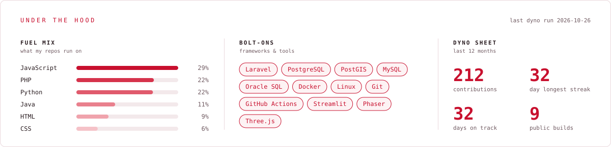

  

 

### 走 &nbsp;Motorháztető alatt

<picture>
  <source media="(prefers-color-scheme: dark)" srcset="dist/stack-dark.svg" />
  <source media="(prefers-color-scheme: light)" srcset="dist/stack-light.svg" />
  
</picture>

### 峠 &nbsp;Garázs

| | Modell | Motor | Mire képes |
|:-:|---|---|---|
| 01 | [**AlgoMario**](https://github.com/Nasmgerg/AlgoMario) | JavaScript · Phaser · Vite | Hat útkereső algoritmus (BFS, DFS, Dijkstra, A\*, Greedy, Best-First) versenyez ugyanazon a pályán, mérhető eredményekkel és benchmarkkal |
| 02 | [**AI Usage & Academic Performance**](https://github.com/Nasmgerg/AI-Usage-And-Student-Academic-Performance-Analysis) | Python · Streamlit · Docker | 50 000 soros adathalmaz elemzése KPI-okkal és korrelációkkal, tesztekkel és CI-jal · [élő demó](https://ai-usage-and-student-academic.onrender.com) |
| 03 | [**quiz**](https://github.com/Nasmgerg/quiz) | PHP · Oracle SQL | Kvízrendszer szerepkörökkel, tárolt eljárásokkal, ranglistával és statisztikákkal |
| 04 | [**szakdolgozatok-nyilvantarto**](https://github.com/Nasmgerg/szakdolgozatok-nyilvantarto) | PHP · MySQL | Szakdolgozat-nyilvántartó admin, hallgató és témavezető szerepkörökkel |
| 05 | [**Mario-A-**](https://github.com/Nasmgerg/Mario-A-) | Java | A\*-alapú ágens, ami időkereten belül tervezi meg Mario útját |
| 06 | [**Magic-forest**](https://github.com/Nasmgerg/Magic-forest) | Three.js | Interaktív 3D varázserdő árnyékokkal, animációval, nappal–éjszaka váltással |
| 07 | [**Casino-Mogul**](https://github.com/Nasmgerg/Casino-Mogul) | JavaScript · Canvas | Körökre osztott, kétjátékos stratégiai játék |

### 道 &nbsp;Útnapló

<picture>
  <source media="(prefers-color-scheme: dark)" srcset="dist/drift-dark.svg" />
  <source media="(prefers-color-scheme: light)" srcset="dist/drift-light.svg" />
  
</picture>
